<!-- Every card is an animated SVG drawn by scripts/render_cards.py and refreshed daily
     by .github/workflows/update-profile-art.yml. Design: matched to zoubaa.dev & brand cyan (#00F2EA).
     Spacing is baked into the SVGs, so keep the row blocks on one line with no spaces between them. -->

   
   
   
   
   
  

  <a href="https://zoubaa.dev">🌐 <b>zoubaa.dev</b></a> &nbsp;·&nbsp;
  <a href="https://www.linkedin.com/in/zoubaa-mohammed">💼 <b>LinkedIn</b></a> &nbsp;·&nbsp;
  <a href="mailto:itsmezoubaa@gmail.com">📧 <b>Email</b></a> &nbsp;·&nbsp;
  <a href="https://github.com/zoubaax">🐙 <b>GitHub</b></a>

---

  
<b>🛠️ Core Technologies &amp; Architecture</b>

   
  

    <code>Java</code> · <code>Spring Boot</code> · <code>PostgreSQL</code> · <code>Docker</code> · <code>Kubernetes</code> · <code>AWS</code> · <code>TypeScript</code> · <code>React</code> · <code>Python</code> · <code>FastAPI</code> · <code>Tailwind CSS</code> · <code>Terraform</code> · <code>GitLab CI</code>
  

